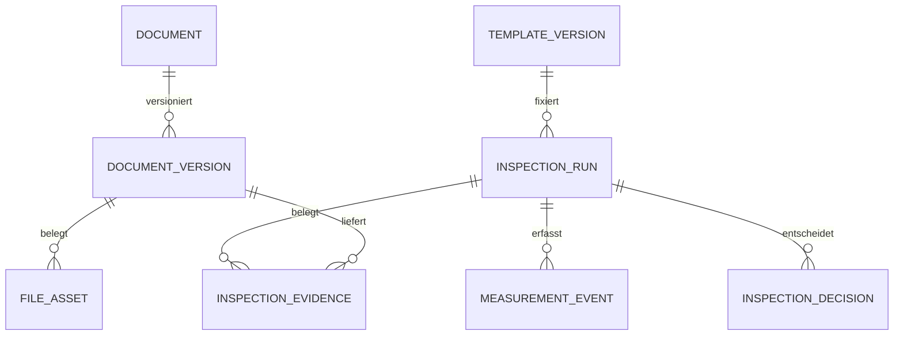

# Vorgeschlagenes Datenmodell und sichere Dateiverwaltung

> **Fortschreibung 14.11.2026:** Für dynamische Fertigungsprüfungen gelten die jüngeren [verbindlichen Qualitätsregeln](../requirements/digital-quality-2026-11-14.md) und die [Änderungs-/Entscheidungsmatrix](digital-quality-acceptance.md). Insbesondere Gelb ohne Vorgesetztenfreigabe, Rotentscheidung AL/berechtigter STV, Qualitäts-Gutteilgate, Nummerierung, Cockpit und Firmenisolation ersetzen abweichende Zielannahmen des Grundentwurfs aus #37. Bestehende Implementierung und historische Nachweise werden dadurch nicht geändert. Das bisherige JSON-Prüfprotokoll bleibt historisch auf #37 bezogen; aktuelle Ergebnisse siehe [neues Prüfprotokoll](digital-quality-validation.json).

Teil des [Konzepts](documents-inspections.md). **Sämtliche neuen Objekte sind P, nicht implementiert und im Originalschema UNVERIFIED.** Kein SQL oder Bucket wird angelegt. Logische UUIDs, exakte Dezimalwerte, UTC-timestamptz und positive bigint-Versionen; spätere SQL-Definitionen erst nach isoliertem Schema-/Owner-/RLS-Review. Bestehende Originalobjekte und Reviewobjekte nicht vermischen.

## 1. Dokumente und Bindungen

| Logisches Objekt (P) | Schlüssel / Daten | Integritätsvertrag |
|---|---|---|
| document_types / type_versions | Typ-ID, stabile Version, Name, erlaubte Formate/Klassifikation/Verfahrensprofil | Freie Typnamen, aber keine frei programmierten Autorisierungsausdrücke. Neue Typen ohne geprüftes Profil geschlossen |
| documents | UUID, Typ, fachlicher Ownerbereich, Klassifikation, Titel, Archivstatus, row_version | Metadatenänderungen auditieren. Unveränderliche Identität, keine Rechte aus Dateipfad/Name. Kein Kopieren vertraulicher Personalfelder |
| document_versions | UUID, document_id, fortlaufende Version, Vorgänger, Status, Änderungsgrund, Actor/Serverzeiten, Inhaltshash, freigegebener Metadatensnapshot | Unique(document_id,version); freigegebene Version unveränderlich. Keine hard deletes/Cascadeverluste geschützter Referenzen |
| file_assets | UUID, versionsgebundener Bucket/Objectkey, servergeprüfter SHA-256, Bytezahl, erkannter MIME, quarantine/ready/rejected/missing, Prüfungsevidenz | Neuer Objectkey je Datei; kein upsert/Overwrite. Hashintegrität ist keine Malware-/Echtheitsgarantie |
| file_derivations | Originalasset, Derivatasset, Renderertyp/-version/Job, Hash | Vorschau/PDF/OCR als eigene kontrollierte Ableitung, niemals heimlicher Ersatz des Originals |
| document_article_links | Dokumentversion ↔ genaue article_master_revisions-ID, ggf. Ursprungsvorlage | Revision gehört nachweislich zum richtigen Artikel/Bereich. Nummern allein kein FK |
| document_order_links | Dokumentversion ↔ production_orders-ID und belegter BA-Snapshot/Manifeststand | Bestehende Legacy-BA ohne neuen Snapshot brauchen ausdrücklich bestätigten Adapter; kein Number-match-Fallback |
| document_operation_links | Dokumentversion ↔ production_order_operations-ID; order_id mit geprüftem zusammengesetztem FK | OP muss zum verlinkten BA gehören; Mess-Nr./Spannung/OP nicht gleichsetzen |
| document_machine_links | Dokumentversion ↔ production_machines-ID, Zweck/Zeitraum; optional Abschnitt | Maschinenlink ergänzt Kontext, erteilt keine Fertigungs-/Dateirechte und ändert keine Maschinenbindung |
| document_scope_bindings | Explizite erlaubte Objekt-/Bereichs-/Leserprojektion je freigegebenem Link | Kein Link verbreitert Rechte automatisch; Freigabe einer Projektion für weiteren Bereich ist selbst autorisierte Entscheidung |
| document_events / command_receipts | Append-only Ereignisse, Actor/Authority/Objekt/Version/Request-ID/Grund/Ergebnis, versionierte Receipts | Kein Token/Dateiinhalt im Audit. Fehler rollt DB-Mutation und Erfolgsaudit zurück; abgewiesene Versuche separater sanitierter Serverkanal |

Die verknüpften article_master_*/production_order_operations-/Snapshotstrukturen sind im Repository vorhanden, aber ihre produktive Installation nicht nachgewiesen. Beim späteren DDL müssen genaue PK-/FK-/Typen vom geprüften Ziel übernommen werden. Harte typisierte Linktabellen statt ungesichertem `entity_type + beliebige ID`. Linkanlage prüft Ziel, Bereich, Artikel-/BA-/OP-Konsistenz und aktuelle beidseitige Autorität; ein bloßer Fremdschlüssel prüft keine Leseberechtigung.

Eine fachübergreifend gültige Zeichnung kann von mehreren Bereichen verlinkt werden. Das bedeutet keine automatische Vereinigung aller Leserlisten: Berechtigung auf konkreten Nutzungskontext **und** Klassifikation/Version nötig. Ein QS-weites Ergebnisprofil erhält den ausdrücklich beschlossenen abteilungsübergreifenden Zugriff; keine globale Abteilungsmitgliedschaft wird als neue Schranke eingeführt. Interne QS-Notizen und vertrauliche Anhänge erhalten getrennte Projektionen, keine Mischdatei als versehentliche Veröffentlichung.

## 2. Vorlagen und ausgefüllte Protokolle trennen

| Logisches Objekt (P) | Wesentliche Felder | Invariante |
|---|---|---|
| inspection_templates / template_versions | Identität, Version, Artikel-/Zeichnungsbezug, Status, Verfahren, Erfassungsvarianten, Inhalts-/Regelhash | Freigabe friert gesamte Definition inklusive Auswahl/Farben/Grenzen ein; kein allgemeines UPDATE veröffentlichter Regeln |
| inspection_characteristics | template_version_id + stabile Merkmal-ID, Messnummer, Bauteil/Position, Werttyp, Einheit, Soll-/Unter-/Obergrenze, Auflösung, Bewertungsregelversion, Messmittel-/Stichprobenanforderung | Numerischer Bereich konsistent; keine NaN/Infinity, unzulässige Einheit/unsortierte Grenzen. Änderungen nur neue Vorlagenversion |
| characteristic_choices / evaluation_zones | Merkmalbezug, exakter Wert/Code/Label, Rang, Zone/Farbe plus Textstatus, geprüfte Regel | Auswahlgrenzen und Zeichnungstoleranz getrennt. Überschneidungen/ungeklärte Randwerte blockieren Freigabe |
| inspection_runs | UUID, genaue template_version_id, Artikelrevision/BA/OP-Kontext, Variante, Teil-/Los-ID, Sequenz/Anlass, Workflowversion, Status/row_version | Keine laufende Referenz auf latest. Pro Prüflauf freigegebenes Kontextmanifest; keine Änderung auf andere BA nach Einreichung |
| inspection_subjects | Run/Teil-/Baugruppen-/Loskennung mit Namensraum und Beleg | Eindeutigkeitsvertrag D08; ohne bestätigte Identität keine fingierte Serialisierung |
| measurement_events | UUID, Run/Subject/Merkmal, Iteration, typed value/Einheit/Rohangabe, Prüfer-ID aus Serverkontext, Messzeit + Serverzeit, Methode/Messmittelbeleg, Vorgänger/Grund | Nur passende Merkmale der eingefrorenen Vorlage; Wiederholungsmessung eigenständig, keine Ersetzung ursprünglicher Ereignisse |
| inspection_evidence | Run, genaue document_version/Asset, Seitenfolge, original/transcription, Uploader, dokumentierter Prüfer-/Herkunftsnachweis | Uploader ≠ automatisch Prüfer. OCR ist unbestätigter Vorschlag; Bestätigung separat auditiert |
| inspection_decisions | Run-/Ergebnissatzversion/-Hash, Entscheidungstyp, Scope, Begründung, zuständige bestätigte Authority/Person/Serverzeit, Bedingungen/Frist | Keine Entscheidung für inzwischen geänderte Ergebnisse. Rotentscheidung gemäß F06 durch zuständigen AL/berechtigten STV, Detailgrenzen O05; kein Grenzwerte-Edit als Ersatz |
| inspection_corrections | Originalereignis, neuer ergänzender Stand, Grund, Beantragender, ggf. unabhängiger Bestätigender | Original und Entscheidungen bleiben lesbar, Korrekturkette nicht zyklisch; resultierender Freigabestand neu zu bewerten |
| inspection_events / outbox | Statusübergang/Version/Actor, optional deduplizierter Benachrichtigungsauftrag | Erfolgsaudit atomar; keine Namen/Messdaten in ungeprüften Nachrichtenkanälen |

Mehrfachmesspunkte/-prüfer und unterschiedliche Verfahren pro Merkmal sind möglich. Fehlender Wert ≠ null Messwert ≠ N/A ≠ bestanden. Qualitative Prüfung hat eigene codierte Kriterien und keine künstlichen numerischen Toleranzen. Anforderungen an N/A, Nichtmessbarkeit und Stichprobenvollständigkeit müssen vor Vorlagenfreigabe bestätigt werden. Kein allgemeiner Cpk-/SPC-/Gutteilnachweis aus sechs Fotoauswahlwerten oder einer unbestätigten 20-%-Angabe.

Nur Kernbeziehungen dargestellt; Objekt-/Abteilungs-/Versions-/Auditbindungen der Tabellen gelten zusätzlich. Ein leerer Vorlagencontainer ist kein Ergebnis und kein PDF allein eine strukturierte Messreihe.

## 3. Versions- und Transaktionsvertrag

Vorlagenfreigabe, Ergebniseinreichung, Korrektur, Entscheidung und Linkänderung als getrennte semantische Serverkommandos. Keine universelle Patch-/CRUD-/SQL-Schnittstelle. Actor aus verifizierter Serveridentität; frei übermittelte Prüfer-/Freigeber-ID nicht als Authority. Attributierung einer historischen Papierprüfung braucht geprüften Quellen-/Importvertrag, nicht impersonation.

Ein Kommando: Request-ID und erwartete Objekt-/Identitäts-/Authorityversion → einheitliche Sperrreihenfolge (Identität, Freigaben, fachliches Elternobjekt, Prüflauf/Version, Kindereignisse) → aktuelle Autorisierung nach Sperrwartezeit erneut prüfen → Fach-/Ziel-/Grenz-/Statusbedingungen → Zustand, Erfolgsaudit, Receipt und ggf. Outbox gemeinsam committen. Idempotente Wiederholung nur bei exakt gleichem Inhalt und aktuell gültigen Leserechten; keine Wiederverwendung eines alten Allow nach Widerruf. Konflikt verlangt erneute bewusste Prüfung, kein ungeprüfter Retry eines Schreibbefehls.

Vorlagenrevision ändert keine alten Prüfungen oder BA-Dokumentmanifeste. Eine später als fehlerhaft erkannte Vorlage wird zurückgezogen und eine betroffene-Prüfungen-Liste zur Fachprüfung erzeugt; alte Belege nicht umrechnen/überschreiben. Verlinkte und freigegebene Daten bleiben erhalten. Datensätze ohne sichere Artikel-/BA-/OP-Zuordnung in gekennzeichnete Klärung, kein unsicherer Legacyfallback. Ein allgemeiner Dokumentenstatus ist keine BA-/OP-Lifecyclemutation. Für den neuen digitalen Qualitätsablauf sind F02/F05–F07 als eigene zukünftige atomare Zähler-/Sperrkommandos beschlossen; konkrete Integration im [Technikentwurf](digital-quality-model.md).

## 4. Supabase Storage – vorgeschlagene geschlossene Architektur

Produktive Storagekonfiguration ist **UNVERIFIED** und wurde nicht abgefragt. Neue private Buckets z.B. `manufacturing-quarantine`, `manufacturing-documents` und `manufacturing-previews` ausschließlich als P. Pfadform aus opaken UUIDs, z.B. document/version/asset; keine Namen/BA-/Kunden-/Personalnummern im URLpfad. Originaldateiname als validiertes geschütztes Metadatum. Bucket-/Pfadbesitz ist kein fachlicher Berechtigungsbeweis.

Private Buckets benötigen Zugriffskontrolle auch beim Download; öffentliche Buckets scheiden aus. Supabase Storage basiert hierfür auf `storage.objects`-RLS. Service-Keys umgehen diese Regeln; deshalb kein Service-/S3-Schlüssel im Browser und keine Annahme, dass RLS einen privilegierten Worker kontrolliert. Quelle, am 13.11.2026 gelesen: [Private Buckets](https://supabase.com/docs/guides/storage/buckets/fundamentals), [Storage Access Control](https://supabase.com/docs/guides/storage/security/access-control). Konkrete Policies/Owner/EXECUTE/Defaults erst nach Originalabgleich und nativer Abnahme.

**P: vermittelter Serverpfad** für sensible Dateien: jeder List-/Preview-/Download-/Export-Aufruf prüft aktuelle Identität, Session-/Berechtigungsversion, Objektbindung und erlaubte Projektion. Auch Range-/Thumbnail-/Konvertierungs-/S3-/Copy-/Move-Pfade dürfen keine Umgehung erlauben. Notwendige privilegierte Storageoperationen nur in eng begrenztem Worker, ohne frei vom Client gewählten Bucket/Key und ohne allgemeines SQL. Kein breites Storage-SELECT für alle authenticated.

Signierte URLs sind weitergebbare zeitbegrenzte Zugriffsbelege; ihre sofortige nutzerbezogene Widerrufbarkeit wird **nicht** versprochen. Deshalb Vorschlag: autorisierter Stream für vertrauliche Downloads, keine langlebigen Client-URLs oder URLtokens in Logs/History/QR. Falls D10 signierte Downloads erlaubt, Restgültigkeits-/Leakrisiko ausdrücklich akzeptieren, Laufzeit begrenzen und real prüfen. Bereits ausgelieferte Bytes/Prints sind nicht rückrufbar. Stream-/Rangeanforderungen neu prüfen und laufende Übertragungen über versionierte Abbruchsignale begrenzen; vollständige Sofortwirkung bei Netzpuffern nicht vortäuschen.

Keine vertraulichen Dateien/Vorschauen in localStorage, IndexedDB, Service-Worker-/öffentlichen CDN-Caches; private/no-store-Antworten, geschützte Renderer, sichere Content-Disposition und MIME-/CSP-Grenzen. Objekt-URLs/DOM bei Sessionwechsel freigeben. Bildschirmfoto/privater Download bleibt organisatorisches Restrisiko. TA-Systemverwaltung verleiht keine fachlichen Lese-/Freigaberechte; Infrastruktur-/DBA-/Schlüsselbesitz separat kontrollieren.

## 5. Upload und Fehlerkonsistenz

Storage und DB bilden **keine gemeinsame atomare Transaktion**. Vorgeschlagene Zustandsmaschine statt falscher Atomaritätsbehauptung:

1. Authentifiziertes `begin_upload` reserviert kurzlebige, einmalige Upload-ID, exact Zielversion, zugelassene Größe/Typ und neuen Objectkey; State pending. Noch nicht im allgemeinen Dokumentlesen sichtbar.
2. Übertragung nur in Quarantäne; kein Überschreiben, Rechtewechsel vor Abschluss prüfen. Timeout, Byte-/Quotenlimit, abbrechbare/resumierbare Übertragung nur für dieselbe freigegebene Reservation.
3. Isolierter Worker prüft echte Dateisignatur/MIME, Hash, Größe, Schadcode, Makros, Container-/Zipbomben, eingebettete Aktionen und Verschlüsselung; Parser ohne Netzwerk und mit CPU/RAM/Deadline-Limit. Keine externen Dokumentinhalte nachladen. OCR/EXIF nicht als Vertrauen verwenden, unnötige sensible Metadaten aus Vorschauen entfernen, Original getrennt bewahren.
4. Validiertes Objekt bleibt geschlossen, bis `finalize` aktuellen Actor/Scope/Version, unveränderten Assethash und erfolgreichen Prüfjob in einer DB-Transaktion mit Link/Audit/Status ready bestätigt. Nur der genehmigte Inhalt wird sichtbar. Veröffentlichung/Freigabe zusätzlich eigener Fachschritt.
5. Netzwerkfehler: Reservation/Jobstatus statt blind neu buchen. Vorheriges freigegebenes Dokument bleibt erhalten. Kaputte/verwaiste Uploads nicht als Bestand zählen. Bereinigung nur autorisiert, begrenzt und nach Frist-/Hold-/Referenzprüfung; kein Löschjob in diesem Auftrag. Fehlender Objectstoreinhalt → missing/gesperrter Abruf, Warnung und Recovery, keine erfolgreiche Freigabe vortäuschen.

Auch Derivate/Exportjobs prüfen vor Auslieferung erneut Rechte; Retry nur dedupliziert/limitiert und ohne erneute Fachfreigabe. Ein neuer SHA beweist Inhaltswechsel, aber nicht, wer das Papier unterschrieben hat. Append-only in App/DB ist keine WORM-Garantie gegen DBA; unveränderbare externe Aufbewahrung bei Bedarf nach D11 separat vorsehen.

## 6. Backup, Retention und Recovery

Dokumentklassen, Vorlagen, Ergebnisse, Korrekturen, Audits und Anhänge erhalten eine fachlich/rechtlich bestätigte Fristen-/Holdmatrix. **Der 8A-Default fünf Jahre ab letzter Änderung/manuelle Löschfreigabe gilt für Vertretungsprotokolle, nicht automatisch für QS-Dokumente.** Keine neue Frist oder globale Löschvollmacht erfinden. GL-/TA-Konfiguration aus 8A erzeugt weder QS-Inhaltslesen noch QS-Löschrecht. Keine Löschung/Automatik in diesem Paket.

Getrennte verschlüsselte Sicherung von DB-Metadaten/ACLs/Vorlagen/Ereignissen und vollständigen Storagebytes samt Hashmanifest, Derivaten, Schlüsseln und Versionsbezügen planen. Supabase-DB-Backups enthalten keine über die Storage-API gespeicherten Dateiobjekte; DB-PITR allein genügt daher nicht ([offizielle Backupdokumentation](https://supabase.com/docs/guides/platform/backups), gelesen 13.11.2026). Keine bestehende RPO-/RTO-/PITR-Verfügbarkeit behaupten.

Unabhängige isolierte Restoreprobe: gemeinsamer Sicherungsstichtag/Journal → DB/Storage getrennt restaurieren → alle referenzierten Objekte/Hashes/Seiten/Versionen/Signaturbelege prüfen → keine unberechtigten ACL-/Owner-/Sessionfreigaben wiederherstellen → echte Rollenlese-/Widerrufs-/Exporttests → RPO/RTO messen. Kein Restore auf Produktion. Bei späterem Integrationsfehler neuer Bereich in sicheren Wartungszustand, bisherige Fachmodule unverändert; keine unsicheren Altpolicies als Rückfall. Bereits neue Prüf-/Auditdaten erhalten, Vorwärtskorrektur oder kontrollierter Recoveryabgleich statt destruktivem Schema-Downgrade.
