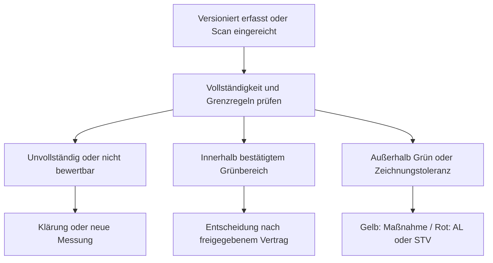

# Berechtigungen, Prüfentscheidungen und Korrekturen

> **Fortschreibung 14.11.2026:** Für dynamische Fertigungsprüfungen gelten die jüngeren [verbindlichen Qualitätsregeln](../requirements/digital-quality-2026-11-14.md) und die [Änderungs-/Entscheidungsmatrix](digital-quality-acceptance.md). Insbesondere Gelb ohne Vorgesetztenfreigabe, Rotentscheidung AL/berechtigter STV, Qualitäts-Gutteilgate, Nummerierung, Cockpit und Firmenisolation ersetzen abweichende Zielannahmen des Grundentwurfs aus #37. Bestehende Implementierung und historische Nachweise werden dadurch nicht geändert. Das bisherige JSON-Prüfprotokoll bleibt historisch auf #37 bezogen; aktuelle Ergebnisse siehe [neues Prüfprotokoll](digital-quality-validation.json).

Teil des [Konzepts](documents-inspections.md); B/P/O gelten wie dort. **Keine dieser Berechtigungen wird aktiviert.** Grundlage [8A-Matrix](permissions-8a-matrix.md), [8A-Entscheidungen](permissions-8a-decisions.md), [8B2-Grenzen](../security/permissions-8b2.md). QS ist ein explizites Modulprofil, keine neue Organisationsrangstufe. Mitarbeiter mit mehreren Rollen handeln unter konkret nachgewiesener Authority; keine Selbstfreigabe oder indirekte Rechteausweitung.

## 1. Verbindliche neue QS-Regeln (B)

| ID | Beschluss | Harte Grenze |
|---|---|---|
| Q01 | QS-Mitarbeiter lesen Fertigungsaufträge und Arbeitsgänge **aller Produktionsabteilungen** | Keine neue allgemeine Produktionsverwaltung, Umplanung, Buchung, Personal-/Gesundheitsdatensicht. Datensparsame fachliche Projektion statt employees.* oder Vollstate |
| Q02 | QS-Mitarbeiter dürfen Prüfergebnisse direkt erfassen | Keine automatische Vorlagen-/Grenzwertänderung, Freigabe oder Korrektur fremder Ergebnisse |
| Q03 | Produktionsmitarbeiter dürfen Prüfergebnisse einschließlich **Name des Prüfers** einsehen | Keine unnötige Auth-ID/Personalnummer/Kontaktdaten; genaues BA-/Abteilungssichtfeld und Entwurfs-/Historysicht D09 |
| Q04 | Produktionsmitarbeiter dürfen QS-Ergebnisse weder verändern **noch kommentieren** | Auch REST-/RPC-/Anhangs-/Korrektur-/Kommentar-/reaktionsbasierte Umwege verweigern; kein berechtigungsfreier allgemeiner Diskussionsbereich an QS-Ergebnissen |
| Q05 | QS-Abteilungsleiter darf zunächst **nur Personen mit QS-Zuordnung** für QS-Aufgaben berechtigen | Eigene zulässige Rechte ∩ Zuständigkeit ∩ ausdrückliche Delegierbarkeit. Keine eigene höhere Rolle, kein QS-Gesamtrecht bloß durch Mitgliedschaft; Definition gültiger QS-Zuordnung D05 |
| Q06 | Prüfung und Korrektur nachvollziehbar dokumentieren | Original/Korrektur/Entscheidung/Actor/Zeit/Grund versioniert erhalten; Produktionskommentare sind kein Korrekturworkflow |

QS-weites BA-/OP-Lesen wird als explizites Produktionsabteilungen umfassendes Leserprofil modelliert, nicht durch automatisches Hinzufügen zu jeder Abteilung oder Umschreiben von employees.role. Neue Abteilung muss kontrolliert in den definierten Produktionsbereich einbezogen werden. AL QS kann entsprechend Q05 ein bereits rechtmäßig gehaltenes delegierbares QS-Profil vergeben; es bekommt keine Organisations-Ernennung, HR- oder Technikrechte. STV braucht zusätzlich die nach 8A erforderliche Freigabe für Sonderrechte; keine pauschale QS-Vergabe aus Vertretung.

## 2. Aktionsmatrix

**–** = kein Anspruch aus dieser Rolle allein; zusätzliche ausdrücklich freigegebene Rolle bleibt separat prüfbar. **O/gesperrt** = nicht freischalten, bevor die genannte Fachentscheidung gefallen ist. B verlangt weiterhin sichere Identität und technische Abnahme, kein Frontend-Rollenstring genügt.

| Aktion | QS-Mitarbeiter | AL QS | Produktionsmitarbeiter | AL Produktion / PL / GL | HR / technischer Admin | Scanner |
|---|---|---|---|---|---|---|
| BA-/OP-Prüfkontext lesen | **B Q01**, alle Produktionsabteilungen | Bei QS-Leserprofil B | Bestehende Fachleserechte, keine Erweiterung durch dieses Konzept | Bestehende explizite Zuständigkeiten | – ohne separat bestätigte Fachrolle | – |
| QS-Ergebnis + Prüfername lesen | **P** notwendige eigene QS-Aufgabensicht; Detailumfang D09 | Wie QS plus ausdrücklich zuständiger Reviewumfang | **B Q03**, Scope/Statusdetails D09 | Nur bestätigtes Fachleseprofil, kein grenzenloser Titelzugriff | – | – |
| Prüfergebnis direkt erfassen / einreichen | **B Q02**, gültige konkrete QS-Aufgabe | Bei eigenem Erfassungsprofil B | – für QS-Ergebnisse | – ohne QS-Erfassungsrolle | – | – |
| Scan zu QS-Prüfung hochladen | **P**, eigener Evidence-Uploadgrant | P wie QS | O D01/D05: Papierprüfer-/Uploaderkreis, keine automatische QS-Schreibbefugnis | O, kein Default | – | – |
| QS-Ergebnis kommentieren/ändern | Kein allgemeines Kommentar-/UPDATE-Recht; Korrekturvertrag D07 | Kein pauschales Override | **B Q04: verboten** | Kein Eingriff aus Leitungstitel allein | – | – |
| Korrektur/Neumessung | P: additive eigene Anfrage; Ausführung/Fremdkorrektur D07 | O D07 | – an QS-Ergebnissen | O D07 | – aus technischer/HR-Rolle | – |
| Vorlage/Zeichnung hochladen, ändern, veröffentlichen | O D05, separat getrennte Aktionen | Kein automatisches Vorlagenfreigaberecht | – ohne bestätigtes Autorenprofil | O, explizite Dokumentverantwortung | – aus Technikrolle | – |
| Qualitätsentscheidung im neuen digitalen Ablauf | Keine rote Entscheidung aus QS-Erfassung allein | Nur bei passender zuständiger AL-Authority | Eigene Fertigungsprüfung/Maßnahme nach F02/F05; keine Änderung fremder QS-Ergebnisse | **B F06:** zuständiger AL/berechtigter STV entscheidet Rot; PL/GL nicht aus Titel allein. **F05:** Gelb nur Kenntnisnahme, keine Freigabe | – | – |
| QS-Aufgabenberechtigung erteilen | – | **B Q05** plus 8A-Delegationsgrenzen | – | Nur separat bestätigte Vergabeauthority, keine neue Regel hier | – | – |
| Download/Druck/Massenexport | O D10, zusätzlich zur Sicht | O D10 | O D10, Lesen ist kein ungeprüfter Massenexport | O D10 | Kein Inhalt aus Systemkonfiguration | – |
| Retention/Löschfreigabe/physisch löschen | O D11, nichts implementiert | O D11 | – | O D11 | Kein QS-Inhalts-/Löschrecht aus 8A-Konfiguration | – |

Q03 darf bei D09 nicht versehentlich zu einem reinen QS-only-Lesemodell werden. Gleichzeitig legt der Auftrag keine unbeschränkte Sicht aller Produktionsmitarbeiter auf sämtliche Artikel/Kunden/BAs und unveröffentlichte Entwürfe fest. Bis Beschluss sind diese neuen Projektionen deaktiviert; bestehende Fachlesepfade bleiben unverändert.

Rechte auf Dokumentlisten, Dateiinhalte, Vorlagen, Originalscans und Derivate getrennt. Der gebilligte Prüfername muss in der Produktions-Ergebnisprojektion enthalten sein; das gibt keinen Zugriff auf verknüpften privaten Personalstamm oder vertrauliche Scanrandnotizen. Uploads mit solchen Inhalten zuerst klassifizieren und gegebenenfalls getrennte freigegebene Darstellung erzeugen. Von HR erlaubte Vertretungsprotokollsicht aus 8A erteilt **keine QS-Gesamtsicht**.

## 3. Serverseitige Durchsetzung

Vorgeschlagene getrennte Aktionsfamilien: documents.metadata.read, documents.content.read, documents.upload, documents.revise, documents.link, documents.publish, documents.export; inspections.context.read, inspections.capture, inspections.submit, inspections.result.read, inspections.correction.request, inspections.correction.apply, inspections.review, inspections.release_standard, inspections.release_exception. **Nur Entwurfsnamen**, leere geschlossene Kataloge bis Fach-/Securityreview. Keine universelle can_manage-/Adminwildcard. Reservierte Organisations-/Identitätsaktionen niemals in Dokumentprofilen.

Actor aus verifiziertem Server-/Auth-Kontext plus aktueller unabhängiger Identitäts-/Session-/Berechtigungsversion. Keine Autorisierung aus user_metadata, schreibbaren employees.role, Uploader-/Prüfer-ID im Payload oder bloßem Besitz eines Objectkeys. Vor jedem sicheren Write dieselbe Authority innerhalb der geschützten Transaktion nach Sperren erneut prüfen. Abgelaufen/widerrufen/inaktiv/uneindeutig/fremd standardmäßig verweigern; Idempotenzantworten, Exporte, Hintergrundjobs, Realtime und Downloads ebenfalls prüfen.

Neue Tabellen geschlossen, RLS/ACL/Spalten-/Default-/Owner-/Funktionsrechte gemeinsam. Views nach Möglichkeit security_invoker, notwendige privilegierte Routinen privat mit minimalem Owner, leerem Suchpfad, qualifizierten Namen und kontrolliertem EXECUTE. Kein Browser-Service-Key. Bestehender 8B2-SQL-Loginpfad ist **kein** sofort nutzbarer authenticator-/PostgREST-Adapter; der echte Verifikations-/Enrollmentpfad bleibt Blocker. Kein Legacy-Allow-OR und keine SELECT*-Ersatzlösung.

## 4. Getrennte Statusdimensionen (P)

Dokumentlebenszyklus: Entwurf → zur Dokumentprüfung → veröffentlicht → ersetzt/archiviert/zurückgezogen. Datei separat pending/quarantine/ready/rejected/missing. Vorlage separat Entwurf → fachlich geprüft → freigegeben → ersetzt/gesperrt. Kein ready-Dateistatus bedeutet fachlich freigegeben.

Prüflauf: Entwurf → in Erfassung → eingereicht → in Prüfung → Entscheidung dokumentiert; zusätzliche Zustände Klärung/Nachprüfung erforderlich. Ergebnisbewertung unabhängig davon: unvollständig/nicht bewertbar, innerhalb Zeichnungstoleranz, außerhalb Zeichnungstoleranz; zusätzlich innerhalb/außerhalb bestätigter interner Grün-/Warnzone. Eine Toleranzbewertung allein erzeugt keine Freigabe.

Historische Papierregel außerhalb Grün bleibt als Fotoquelle erhalten. **Aktueller digitaler Zielvertrag F05/F06:** Gelb verlangt tatsächliche Korrektur, Dokumentation und Prüfung des nächsten Teils; OP bis Dokumentation gesperrt. AL bestätigt nur Kenntnisnahme, keine zusätzliche Freigabe. Rot führt zu In Abklärung; zuständiger AL oder berechtigter STV entscheidet Ausschuss, Nacharbeit oder zulässige Sonderfreigabe. Ursprungsmessung bleibt unverändert; Zulässigkeits-/Detailgrenzen nach O05, nicht erneut die grundsätzliche AL-/STV-Zuständigkeit öffnen.

Bestehender Code bleibt unverändert. Zukünftiges Gutteilgate, Gelb-OP-Sperre und automatische Abklärung→Ausschussumbuchung sind nach F02/F05–F07 fachlich beschlossen, aber nicht implementiert. Letztstück-/Spannungs-/Folge-OP-/Versanddetails bleiben O02/O04/O08. QS-Leserechte erlauben keine allgemeine Stückzahl-/Rüst-/Maschinen-/Lifecycleverwaltung.

## 5. Freigabe und Korrektur

Vor Einreichung: vollständiger Kontext, passende freigegebene Vorlage, erforderliche Messwerte/Belege, lesbare komplette Seiten, bekannte Auth-/Prüferattribution. Für B keine automatische Werteextraktion/Passentscheidung. Einreichung friert Ergebnissatz/-Hash ein. Entscheidung bindet exakt diesen Stand; neue Messung/Korrektur erfordert neuen zu prüfenden Stand, keine Übertragung alter Freigabe ohne Prüfung.

Korrektur als referenzierter Zusatz mit Altbezug, neuem Wert/Beleg, kurzer Pflichtbegründung, Actor/Serverzeit/Authority und gegebenenfalls bestätigendem Prüfer. Original nicht überschreiben, auch nicht durch neue Datei unter altem Objectkey. Falscher Scan wird als ersetzt/beanstandet markiert, Original im zulässigen geschützten Verlauf erhalten. Neumessung, Transkriptionsfehler und fachliche Ausnahmeentscheidung sind unterschiedliche Ereignisse. Wer fremde Ergebnisse korrigieren/bestätigen darf, bleibt D07; Q04 wird dadurch nicht aufgeweicht.

Die 8A-Regel „nur GL/PL veranlassen fachliche Korrekturen an Vertretungsprotokollen“ gilt **nicht automatisch für QS-Messprotokolle**. Ebenso erzeugt sie kein produktives QS-Override. Zuständigkeiten für QS, normale Freigabe, Vieraugenprinzip und Betroffenheit getrennt entscheiden. Keine Selbstfreigabe oder Freigabe eigener höherer Rechte über Rollenkombinationen. Papier-Visum/gescannte Unterschrift ist keine behauptete qualifizierte elektronische Signatur; gewünschtes Signaturniveau D14.

Erfolgreiche Fachaktionen/Audit gemeinsam committen, keine teilweise angewandte Entscheidung bei Auditfehler. Auditansicht zweck- und bereichsgebunden; technischer Betrieb nur sanitisierte Fehler-/Jobdaten. Kein Dateitext, Gesundheitsdatum, Token oder freier Vollrequest in Logs. Denial-Audit benötigt separaten vertrauenswürdigen Kanal, da SQL-Rollback auch dort eingefügte Auditzeilen zurückrollen würde.
