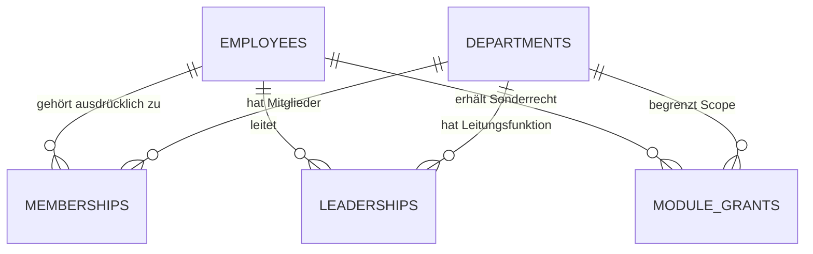

# Schritt 8A – vorgeschlagenes Datenmodell und Durchsetzungsvertrag

**Nur technische Konzeption. Keine DDL, Migration, neuen RPCs oder Berechtigungsdaten implementiert.** B/P/O-Notation und bestätigte Matrix siehe [Bestandsaufnahme](modular-permissions-8a.md) und [Matrix](permissions-8a-matrix.md). Alle neuen Objekte nachfolgend sind P. Vorhandene Originalobjekte sind nur employees/departments u.a. gemäß datiertem #32-Katalog; humbel_security ist bislang ein isolierter Reviewkandidat.

## D1. Stabile Identität statt einzelner Profilrolle

`employees.id` bleibt stabile fachliche Person-ID, `departments.id` stabile Bereichs-ID. `employees.department_id` bleibt als organisatorische Stammabteilung erhalten, nicht als Gesamtheit der Mitgliedschaften oder Leitungsrechte. Freitext department, Displayname, Slot oder Personalnummer verleihen niemals Authority. Beschäftigte ohne Login dürfen weiterhin als Planungsziel existieren; ohne eindeutige aktive Authbindung erhalten sie keinen eigenen Zugriff.

Die vorgeschlagene Weiterentwicklung von **humbel_security.principals** behält unabhängig geprüfte Auth-ID↔Person-Bindung, enabled, Evidenz und zeitliche Gültigkeit. Ergänzt werden Bindungs-/Berechtigungsversion und Lifecyclezustand. Die bisherigen skalaren role/department_id dürfen erst nach vollständigem Adaptercutover zu kontrollierten Kompatibilitätsfeldern werden. Sie dürfen nicht einfach aus der Prüfung entfernt werden, solange alte Helper/Policies darauf vertrauen.

Im Ziel trennt die vertrauenswürdige Identitätswurzel den aktiven Actor von dessen Rollen-/Bereichszuweisungen. Ein serverseitiger v2-Kontext liefert eigene IDs, Version und minimale **Aktions-/Scopefähigkeiten**, keine fremden Personal-/Gesundheitsdaten. Keine Autorisierung aus JWT user_metadata, lokalen Profilobjekten oder reinen Frontend-Rollen. Auch verifizierte JWTs ersetzen keine aktuelle DB-Aktivitäts-/Widerrufsprüfung.

## D2. Relationen, Schlüssel und Invarianten

Logische Typen sind UUID, Textkatalogschlüssel, timestamptz, bigint-Version und unveränderliche Audit-/Evidenzreferenz. Konkrete SQL-Ausgestaltung folgt später nach Restore/Review, keine behaupteten Originaltabellen.

| Vorgeschlagenes Objekt / Erweiterung | Wesentliche Felder und Beziehungen | Zwingende Bedingung |
|---|---|---|
| principals (Weiterentwicklung des Kandidaten) | user_id↔employee_id eindeutig, enabled/lifecycle, binding_version, authorization_epoch, valid_until, evidence | Eindeutiger aktiver Actor; keine Wiederverwendung alter Authbindungen ohne neue Freigabe. Auth-/Person-Zuweisung nicht aus Profilrolle backfillen |
| permission_catalog / role_profiles | Stabile module/action/resource/field_projection-Schlüssel, scope_kind, Sensitivität, delegierbar, unveränderliche Profilversion | Keine frei eingebbaren SQL-/JSON-Policyausdrücke und keine selbst editierbaren Capabilitykataloge; Organisations-Ernennungen nicht als Modulsonderrecht |
| organization_role_assignments | employee_id, role_code aus sieben Rollen, ausdrücklicher Organisationsscope, valid_from/valid_until, approval/issuer, Version/Widerruf | PL-Ernennung/-Abberufung ausschließlich durch aktive GL; AL-Ernennung/-Abberufung durch GL oder PL, keine Selbsternennung/Selbstfreigabe. Leerer Departmentwert ist keine implizite Globalvollmacht |
| department_memberships | membership_id, employee_id, department_id, Aktivitätszeitraum, Status/Evidenz, Version | N:M; doppelte gleichzeitig wirksame gleiche Zuordnung verhindern. Mitgliedschaft ist keine Leitung und kein automatischer Modulgrant |
| employees.department_id als Primärverweis | Existierendes Feld, durch gesichertes Stammwechselkommando gepflegt; Historie im Audit | Menschlicher gültiger Primärbereich muss zur bestätigten aktuellen Mitgliedschaft passen. Unklare Alt-/Nullwerte erst abgleichen, keine Abteilung erfinden. Kein zweites widersprüchliches is_primary-Flag als Autoritätsquelle |
| department_leaderships | leadership_id, department_id, employee_id, Zeitraum, Ernennung/Abberufung durch GL oder PL/Evidenz, Status/Version | Eine Person darf mehrere Bereiche gleichberechtigt leiten. Gleichzeitige mehrere Leiter derselben Abteilung bleibt O03; bis Entscheidung bestehende eindeutige Leitungssemantik erhalten |
| department_deputies | deputy_id, department_id, employee_id, vertretene Leitungsfunktion, Zeitraum, operative Grenzen, Genehmigung | PL ernennt, AL benennt nur im eigenen Zuständigkeitsbereich; keine Selbsternennung. Jede Abteilung eigene Zuweisung; dieselbe Person in mehreren Abteilungen nur über separate ausdrückliche Zuweisungen. Keine pauschale Abteilungsübertragung |
| module_special_grants | grant_id, employee_id, module/profile_version, **ein department_id je Grant**, konkrete Aktions-/Feldobergrenze, Zeitraum, Status, issuance_decision_id, primary_epoch, bundle_id | Mehrere ausgewählte Abteilungen werden als explizite Grantzeilen eines atomaren Batches gespeichert. Kein Wildcard-/Arraywert mit implizitem Globalrecht |
| issuance_decisions / approvals | Actor, Ziel, geprüfte eigene Authority/Snapshot/Version, Umfang/Zeitraum, Freigebender, Request-ID, Serverzeit | Belegt tatsächliche Berechtigung **bei Erteilung**; Sonderrollenvergabe durch STV braucht passende unabhängige Freigabe. Keine Selbstbestätigung höherer Rechte |
| leadership_availability | Abteilung/Funktionszuweisung, present/absent/unknown, gültiger Zeitraum, vertrauenswürdige operative Quelle/Version | Nur operative Verfügbarkeit, **keine Diagnose/Krankheitsnotiz**. Kein Schluss aus Offline/Loginstatus; unbekannt/stale ist kein Beweis einer Abwesenheit |
| acting_authority_events / fallback_episodes | Actor, vertretene Funktion, Abteilung, Aktion, Ereigniszeitpunkt, Auslöser/Availabilityversion, Authority, Zeitraum, Request-ID | Delegierte Handlung nachvollziehbar; PL-Fallback pro Abteilungs-/Ausfallepisode eindeutig. Rolle einer Person nicht persistent auf admin/AL überschreiben |
| permission_reviews | grant_id, zuständige neue Leitung, Anlass/Ergebnis/optional vereinbarte Frist, Status | Review ist ein eigener Workflow, kein heimlicher Grantablauf; gültige Grants bleiben beim Handover erhalten |
| authorization_audit / notification_outbox | Actor/Ziel/Scope/Aktion/Authority-/Versionsreferenzen, Request-/Episode-ID, minimale Änderungen; Nachrichtentyp/Empfänger/Deliverystatus | Append-only, kein pauschaler Rohpayload mit Personal-/Gesundheitsdaten. Eindeutige Idempotenzschlüssel, keine automatische doppelte Nachricht |

AL-/STV-Organisationszuweisung und konkrete Leitungs-/Vertretungsfunktion dürfen keine zwei unabhängig erteilbaren Vollmachten werden: Bereichsrechte entstehen nur aus der jeweils gültigen konkreten Funktionszuweisung samt bestätigtem Rollenprofil. Verknüpfung und Lifecycle werden atomar gepflegt; ein bloßer AL-/STV-Rollentitel ohne gültigen Bereich erteilt keine operative Authority. Die technische Ausprägung als verknüpfte Relation oder abgeleitete Rollenprojektion ist im späteren Schema-Review festzulegen.

Begrenzte/unbegrenzte Vergabe: valid_from ist servergeprüft; valid_until darf bei Sonderrollen **NULL als ausdrücklich unbefristet** sein. Endliche Intervalle brauchen Ende > Beginn. Wirksamkeit in UTC mit halboffener Grenze [von,bis), bei unbefristet ohne obere Grenze. Anzeige nach Betriebszeitzone, DST-/Grenztests. Keine Jahreszahl 9999 als Scheinbefristung und keine Übertragung von NULL in alte expires_at>now-Prädikate, die unbemerkt alles sperren.

Zeitliche Eindeutigkeit kann nicht durch einen bloßen UNIQUE-Schlüssel auf Mitarbeiter/Abteilung allein abgedeckt werden: Historie, zukünftige Zeiträume und Überlappung müssen durch passende Datenbankconstraints und gesperrte serverseitige Schreibkommandos konsistent sein. Harte Fremdschlüssel/Relationen dürfen nicht zugunsten bloßer Text-IDs entfallen. Historische Vergaben/Audits nicht über generisches CRUD hart löschen. Vertretungsprotokoll/Korrekturhistorie innerhalb geltender Frist unveränderbar; danach nur nach D7, gesetzlichen Vorgaben und geklärtem O17. Für andere Datenklassen bleiben Aufbewahrung/Pseudonymisierung O10/O16.

Diagramm: lediglich die Kerntrennung, **keine vorhandene Produktions-DDL**. Auth-, Zeit-, Approval- und Auditbedingungen aus der Tabelle gelten zusätzlich.

## D3. Vergabe und Delegationsobergrenzen

Ein semantisches Vergabekommando ermittelt den Actor aus vertrauenswürdiger Session, sperrt/prüft relevante Identitäts-, Bereichs-, Authority- und Zielversionen und validiert **jede** ausgewählte Abteilung. Zulässige Ausgabe ist höchstens:

- eigene aktuelle, ausdrücklich delegierbare Aktions-/Feldberechtigungen des Actors;
- geschnitten mit seiner aktuellen Zuständigkeit und mit dem freigegebenen Modul-/Templateumfang;
- für konkret ausgewählte Ziele/Abteilungen und einen zulässigen Zeitraum;
- mit zusätzlicher Freigabe, falls der Actor als Stellvertreter handelt.

Eigene Rechte allein reichen nicht zur Erteilung einer reservierten Organisationsrolle. Ein Modulprofil darf keine Ernennung zum PL/GL/HR oder nachträgliche Bearbeitung von Authbindungen verstecken. Durch Zusammenlegen mehrerer kleiner Grants entsteht keine neue Meta-Vergabebefugnis. Auch ein AL darf sich kein höheres Recht, fremden Scope oder unzulässige Delegierbarkeit geben. Keine Selbsternennung oder Selbstfreigabe, auch nicht durch Rollenkombinationen oder indirekte Ketten. PL-Ernennung/-Abberufung ist ausschließlich GL vorbehalten; AL-Ernennung/-Abberufung GL/PL; STV-Ernennung PL bzw. Benennung durch zuständigen AL. Abberufung von STV O18. Diese Organisationsaktionen und fachliche Protokollkorrekturen sind keine über operatives Vertreten weitergereichten Rechte.

Ob ein **Empfänger** für jedes Sonderrecht Mitglied der Zielabteilung sein muss, ist O08 pro Aktionsklasse. Keine universelle neue Mitgliedschaftspflicht, die bestehende geprüfte Maschinen-/OP-Authority zwischen Abteilungen blockiert. Umgekehrt erzeugt ein Sonderrecht keine automatische Mitgliedschaft. Für noch ungeklärte neue Fremdscopefälle verweigern statt Erlaubnis erraten.

Geplante semantische Kommandos sind getrennt zu benennen, etwa PL ernennen/abberufen (nur GL), AL bestellen/abberufen (GL/PL), STV ernennen/benennen (PL/zuständiger AL), Mitgliedschaft ergänzen, Stammabteilung wechseln, Sondergrant erteilen/widerrufen, STV-Vergabe genehmigen, Actor deaktivieren. Das sind **keine implementierten RPC-Namen**. Kein universeller Write-any-table-/SQL-Runner und kein clientseitig übermittelter Actor als Authority.

## D4. Besondere Lifecyclefälle

### Zusätzliche Mitgliedschaft

Der Benutzer muss ausdrücklich auswählen: konkrete Berechtigungen oder **Keine zusätzlichen Rechte**. Der Server protokolliert diese Entscheidung, erzeugt nicht still ein Rollenpaket und akzeptiert keine nur im UI vorgenommene Auswahl ohne serverseitige Vergabeprüfung. Mitgliedschaft und genehmigter Grantbatch sind fachlich getrennt, aber konsistent/atomar abzuschließen oder als ausdrücklich noch unberechtigte Mitgliedschaft sichtbar zu machen. Kein Teilerfolg A aus einem abgewiesenen A+B-Batch.

### Stammabteilungswechsel (B)

In **einer** autorisierten Transaktion: Ziel-/Versionsprüfung → neue Mitgliedschaft/Primärbeziehung validieren → Primärfeld ändern → sämtliche bisherigen **Sonderrollen über alle Module/Abteilungen und auch unbefristete** suspendieren → primary-/authorization_epoch erhöhen → Audit/Invalidierungsereignis. Rollen nicht löschen; erneute Freigabe als neue auditable Entscheidung, nie automatische Reaktivierung durch Rückwechsel.

Organisationsrolle, Leitung und operative Stellvertretung sind nicht einfach Sonderrollen. Was ein Stammwechsel zusätzlich mit diesen Funktionen macht, ist O14; keine stillschweigende Entfernung einer ausdrücklich beauftragten Mehrfachleitung. Rechte, deren konkrete Membershipvoraussetzung entfällt, müssen nach ihrem bestätigten Vertrag blockiert werden. Sicherheitswurzel/Bindungsprüfung bleibt erhalten.

### Leitungswechsel (B)

Gültige Sonderrollen bleiben bestehen. Die erteilte beständige Abteilungsfreigabe ist deshalb **nicht** als jederzeit von der aktuellen persönlichen AL-Rolle des damaligen Ausstellers abhängiger Pointer modelliert. Issuancebeweis bleibt unveränderlich; verantwortliche Reviewzuständigkeit wechselt auf die neue Leitung. Actor-/Subjektaktivität des Begünstigten, Zeitraum, aktueller Scope und ausdrücklicher Widerruf gelten weiter.

Ein normaler Handover oder das Ausscheiden des damaligen Ausstellers allein entzieht damit nicht automatisch die gültigen Rechte anderer Begünstigter. Ein expliziter Sicherheitswiderruf, eine kompromittierte Freigabe oder eine zentral gesperrte Capability ist ein **anderes** Ereignis. O07 legt den nötigen Nachfolge-/Kaskadenumfang fest; es dürfen weder unerlaubte Rechtekopien fortleben noch alle erlaubten Grants pauschal bei jedem Leiterwechsel verschwinden. Solche Fälle brauchen gezielte Policy-/Audit-/Regressionstests. Reviewerstatus allein gewährt kein unbeschränktes Widerrufsrecht.

### Abwesenheit und operative Stellvertretung (B)

Stellvertreter besitzt bestätigte Zuweisung je Abteilung, aber nicht ständig alle Leiterrechte. Wirksamer operativer Vertretungskontext prüft Zeitraum/Widerruf, aktuelle Zuständigkeit und vertrauenswürdig belegte Leiterabwesenheit. Keine gesundheitlichen Rohdaten in Kontext oder UI. Grantvergabe gehört nicht automatisch zum operativen Paket und braucht die zusätzliche Freigabe O05.

Wenn beide abwesend sind, handelt ein gültig von GL ernannter PL im bestätigten Verantwortungsbereich. Mehrere mögliche PL, fehlender Leiter/STV, widersprüchliche oder veraltete Verfügbarkeit sind O02/O04/O13; niemals den ersten Datensatz, einen Namen oder einen beliebigen Admin wählen. PL hat ohnehin seine bestätigte übergeordnete operative Authority; die Übernahme wird zusätzlich als solche kenntlich/auditiert, nicht als neue HR-/Systemvollmacht.

### PL-Benachrichtigung (B, technische Ausgestaltung P)

Vertrauenswürdige Verfügbarkeitsübergänge erzeugen/aktualisieren die Fallbackepisode und eine deduplizierte Outboxnachricht im selben fachlichen Commit. Ein späterer Übernahmebefehl prüft dieselbe Episode, ohne Nachrichtenduplikat. Auch eine Übernahme ohne sofortige Buchung darf nicht still unbenachrichtigt bleiben. Bestehendes Routing-/Lifecycle-Notificationsmuster wiederverwenden.

RLS-Leseprädikate bleiben **rein lesend**: keine INSERT-/Versand-/Wartungsseiteneffekte beim Prüfen einer SELECT-Policy. Verarbeitung und Versand erfolgen über getrennte vertrauenswürdige Kommandos/Worker. Dauerhafter Outboxeintrag ist Transaktionsbestandteil; scheitert er, darf eine verpflichtend zu protokollierende Übernahme nicht unbemerkt erfolgreich werden. Zustellwiederholungen, Dead Letter, Alarmierung und Kanal/Empfängerentscheidung O13. **In 8A wird keine Nachricht versandt.**

### Deaktivierung/Ausscheiden (B)

Ab bestätigtem Deaktivierungscommit keine neue Serverautorisierung/Mutation mit alten Rollen, Grants, Sessions oder Tokens. Aktorstatus und Berechtigungsversion sind bei jeder Fachaktion aktuell serverseitig zu prüfen; reine JWT-Laufzeit/GetUser-Erfolg genügt nicht. Erhöhen der Actor-/Bindingversion, sichere Session-/Tokenwiderrufsverarbeitung, Invalidation von UI/DOM/Memory/Realtime und vertraulichen Altcaches gehören dazu.

**Präzise Racegrenze:** Mutierende RPCs sperren relevante Actor-/Authorityzeilen in einheitlicher Reihenfolge, prüfen nach Wartezeiten erneut Version/Aktivität und serialisieren mit der Deaktivierung. Vorher begonnene Aktionen müssen vor dem Deaktivierungscommit abgeschlossen oder abgebrochen sein. Keine lange alte Snapshottransaktion, die danach weiter mit alten Grants schreibt; Serializationfehler nicht durch Retry ohne neue Autorisierung umgehen. Zeitlimits, lange Reads/Exports/Subscriptions und Responsegenerationen ausdrücklich abnehmen.

Bereits an einen Client übertragene Informationen können nicht zurückgerufen werden. Das ist keine Begründung für einen Offline-Privatcache: neue sensible Datenzugriffe/Anzeige nach Wechsel/Widerruf müssen verhindert, Speicher bereinigt und die technisch verbleibende In-flight-Grenze geprüft/dokumentiert werden. Reaktivierung nach temporärer Sperre/Austritt O09; bis bestätigtem Verfahren keine automatische Wiederbelebung alter privilegierter Sonderrollen.

## D5. Datenbank, Frontend und Audit gemeinsam

Private Authoritytabellen: keine direkten Clientgrants, kein Bootstrap aus editierbaren Mitarbeitern oder JWT-Metadaten. RLS/ACL/Funktions-/Schema-/Spaltenrechte gemeinsam prüfen. Feldvertraulichkeit braucht minimale Views/RPC-Projektionen und gegebenenfalls getrennte Datenspeicher, nicht nur Row-RLS. Admin-only- oder true-Policies auf sensiblen Basistabellen sind kein Ersatz für die Matrix.

Invokerroutinen bevorzugen; notwendige privilegierte Routinen mit begrenztem Owner, qualifizierten Referenzen, sicherem Suchpfad, explizitem EXECUTE und eigener aktueller Actor-/Scopeprüfung. Keine allgemeinen Service-Role-Clients im Browser. Tatsächliche DBA-/Backup-/Signingkeymacht außerhalb des Approllenmodells kontrollieren. Default Grants dürfen neue Tabellen/Funktionen nicht automatisch wieder breit öffnen.

Ein neuer versionierter Kontext ersetzt nicht heimlich den vier Rollen umfassenden #29-Vertrag. Alte Clients dürfen neue Rollen weder auf admin noch auf employee zurückfallen lassen. Pro Modul bewusst freigeschaltete Fähigkeitsantwort, UI-Versionserkennung und sicherer Nichtverfügbarkeitszustand, bevor die alte UI unpassende Rohdaten lädt.

Idempotente Befehle mit Request-ID/Payloadhash/erwarteter Version und Audit. Auch beim Wiederausgeben eines alten Ergebnisses aktuelle Autorisierung/Feldprojektion prüfen. Lockreihenfolge und after-wait-Prüfung über Identität, Target, Department, Authority/Grant und Fachobjekt festlegen; Parallelität gegen echte PostgreSQL-Verbindungen testen, nicht nur PGlite. Ein Audit-/Outboxfehler rollt die zugehörige Rechteänderung zurück.

## D6. Vertretungsprotokolle und fachliche Korrektur

**B: verbindlicher Fachvertrag.** Jede Vertretungshandlung trägt ausführende Person, vertretene Funktion, betroffene Abteilung, konkrete Aktion und Zeitpunkt. Technische Zusatzreferenzen zu Autoritäts-/Sessionversion und Request-ID sind P für nachvollziehbare, idempotente Durchsetzung. Keine medizinischen Details/Passwörter/Tokens im Protokoll oder in der Pflichtbegründung.

Leitungsebene liest entsprechend ihrer Zuständigkeit; **HR liest sämtliche Vertretungsprotokolle**, einschließlich Korrekturverknüpfungen, ohne operative Bearbeitung. Dafür eine eigene minimale Projektion planen, keine allgemeinen Personal-/Gesundheits-/Rohpayloadgrants. Historische/vertretende Zuständigkeit und eigene STV-Sicht O18. Technische Administration vermittelt kein fachliches Leserecht.

**Nur GL und PL** dürfen innerhalb ihrer Zuständigkeit fachliche Korrekturen veranlassen. Kurze Begründung ist zwingend, Leer-/Whitespacebegründung unzulässig. Korrektur nur als zusätzlicher Eintrag mit Original-/Vorgängerverweis: Originalwerte unverändert, korrigierte fachliche Aussage nachvollziehbar, Veranlasser/Ausführer/Authority/Zeitpunkt und Grund vollständig protokolliert. Auch Korrektur einer Korrektur hängt einen weiteren Eintrag an. Keine stille Löschung, UPDATE-in-place oder nachträgliche Umdatierung. Eine Korrektur beweist/bewirkt **keine** rückwirkende Berechtigung und ändert keine ausgeführte Fachbuchung.

**P: additive Modellobjekte**, keine implementierten Tabellen: acting_log_entries (Pflichtfelder, stabile ID), acting_log_corrections (Original-/Vorgängerverweis, Aussage, Pflichtgrund, Actor/Authority/Serverzeit, Request-ID/Version) sowie eigene geschützte Korrekturaudit-Ereignisse. Aktionsausführung und notwendiger Vertretungsnachweis atomar; fachliche Korrektur und deren Audit atomar. Original und Korrekturketten sind während geltender Aufbewahrung DB-seitig gegen direktes UPDATE/DELETE und unsichere FK-Cascades zu schützen. Konkurrenz/Retry ohne verlorene oder doppelte Korrekturen testen. UI zeigt Original plus nachvollziehbaren Korrekturstand, nicht ein überschriebenes Original.

Technische Integritätsreparatur, Restore oder Indexwartung sind **keine fachliche Korrektur** und verschaffen TA keine GL-/PL-Vollmacht. App-TA bekommt keinen direkten Log-CRUD-/Owner-/Bypasspfad. Tatsächliche DBA-Notfallgewalt bleibt getrennt kontrolliert nach O16; Wiederherstellung darf die Beweishistorie nicht still umschreiben.

## D7. Aufbewahrung, Freigabe und spätere Löschung

**B: konfigurierbare Fachregel nur für Vertretungsprotokolle samt Korrekturhistorie.** Dauer einstellbar, Fristbeginn wählbar **Ereignisdatum oder letzte Änderung**, Verfahren wählbar **automatische Löschung nach Fristablauf oder manuelle Freigabe**. Grundeinstellung **fünf Jahre ab letzter Änderung, manuelle Löschfreigabe**. Historie bleibt während der geltenden Frist unveränderbar; zulässige Korrekturen nach D6 sind additive Ereignisse.

**B: ausschließlich GL und TA** dürfen diese globalen Einstellungen verwalten; PL/AL/STV/HR/MA nicht. Parameterverwaltung ist unabhängig von Inhaltslesen, fachlicher Korrektur und tatsächlicher Löschfreigabe. TA darf Dauer/Fristbasis/Verfahren ändern, ohne vertrauliche Protokoll-/Personal-/Gesundheitsdaten zu erhalten. Einstellungen dürfen keine Rollen-/Scope-/Feldrechte oder Sicherheitsprüfungen ändern. Gesetzliche Aufbewahrungs- und Datenschutzpflichten haben Vorrang; keine konkrete gesetzliche Frist wird aus dem konfigurierten Fünfjahresdefault behauptet.

**P: versionierte Konfigurationsobjekte** retention_policies (Datenklasse, Dauer/Einheit, Fristbasis, Modus, Version/Wirkungszeitpunkt), retention_policy_events (Actor/Authority/Serverzeit, alte/neue Parameter), deletion_decisions (gegebenenfalls berechtigter Freigeber, Kandidatenmanifest/Policyversion, Serverzeit) und separat geschützte Lösch-/Sperrnachweise. Jede Einstellungsänderung und Löschfreigabe protokollieren. Diese Namen sind ausschließlich Modellvorschläge; keine Datenbankobjekte, Jobs, Timer oder Löschendpunkte angelegt.

**Noch offen O17:** konkrete gesetzliche Pflicht-/Sperrmatrix, autorisierte manuelle Freigeber, welche Änderungen den Fristbeginn beeinflussen, Wirkung neuer Policyversionen auf Altprotokolle und technische Ablaufgrenzen. Konfigurationsrecht ist **keine automatische Löschfreigabe**. Bis zur Klärung/Abnahme bleibt der Löschpfad gesperrt; Auswahl eines späteren Automatikmodus erzeugt jetzt keinen Job.

**P für spätere Abnahme:** Original/Korrekturkette als konsistente Einheit behandeln, technische Lesesicht-/Delivery-/Index-/Restoreupdates nicht ungeprüft als fachliche letzte Änderung zählen. Öffnen/Lesen darf keine Frist still verlängern; Korrektur und Fristberechnung müssen nach entschiedenem Vertrag konsistent sein. Kein Missbrauch von Parameterverkürzung/Moduswechsel zur vorzeitigen Löschung. Vor tatsächlicher Bereinigung Policyversion, Freigabe falls manuell, aktuelle Sperren/gesetzliche Pflicht, Ablauf und konkurrierende neue Korrektur erneut atomar prüfen. Automatik nur nach ausdrücklich abgenommenem Modus, niemals vor Ablauf/gegen gesetzliche Sperren. Backups/Replikate, FK-/Korrekturketten und eigener Aufbewahrungsumfang für Konfigurations-/Löschfreigabe-/Korrekturauditnachweise O17; keine rekursive Selbstlöschung des einzigen Nachweises. Außerhalb dieser Datenklasse gelten keine pauschalen Fünfjahres-/Löschänderungen.

**In diesem Auftrag keinerlei tatsächliche Löschung oder automatische Löschfunktion implementiert.** D6/D7 sind spätere additive isolierte Pakete; bestehende SQL-Kandidaten und Geschäftsprozesse bleiben unverändert.
